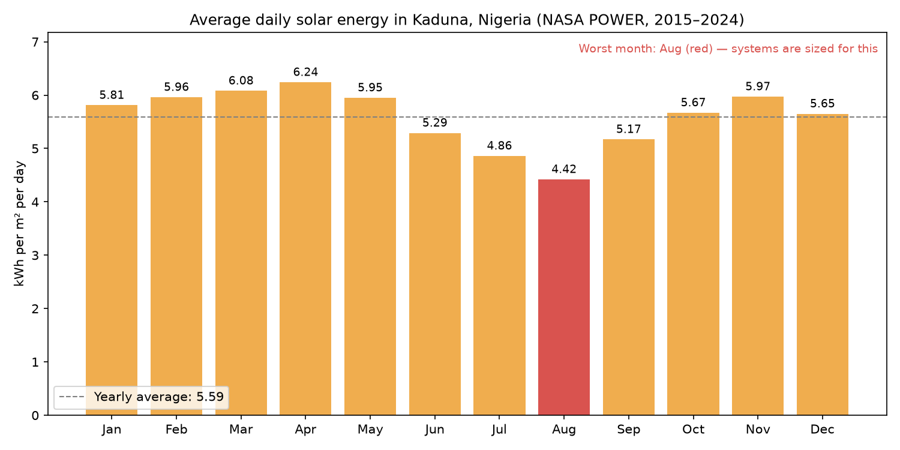

# The Solar Sizer

**Live app:** https://the-solar-sizer-ng.streamlit.app/  •  **Landing page:** https://masterultron.github.io/kaduna-solar-sizer/

Sizing off-grid solar systems for homes and small businesses in Kaduna, Nigeria — using real NASA satellite solar data instead of guesswork.

## Why
Grid power in Nigeria is unreliable, so many households and businesses buy solar systems. Most systems are sized by rough rule-of-thumb, which leads to oversized (wasted money) or undersized (batteries die at night) installations.

## What it does
1. **Data** (`fetch_data.py`, `analyze.py`): downloads 10 years (2015–2024) of daily solar irradiance for Kaduna from NASA POWER and analyses it month by month.
2. **Sizing engine** (`sizing.py`): turns a customer's appliance list into panel, battery, inverter and charge-controller sizes plus cost, designed for the worst (least sunny) month.
3. **Installer app** (`app.py`, `quote_pdf.py`): a web tool for solar installers to size a system and download a one-page branded PDF quote.
4. **Landing page** (`docs/index.html`), published with GitHub Pages.

## Key finding
Kaduna averages **5.59 kWh/m²/day** of sun, but August (peak rainy season) drops to **4.42**, 29% below April's 6.24.
A system sized for sunny months covers only ~85% of a typical home's daily need in August. Sizing for the worst month fixes that.



## Setup
```bash
python3 -m venv .venv
source .venv/bin/activate
pip install -r requirements.txt

python fetch_data.py      # download NASA data (already included in data/)
python analyze.py         # monthly analysis + chart
python sizing.py          # example: size a home system
streamlit run app.py      # open the installer app
```

## Limitations
- Estimates only: a site visit should confirm roof space, shading and wiring.
- Motor start-up surges (fridges, pumps, AC) are not modelled separately; the inverter has a 25% margin.
- Prices are example figures. Installers enter their own.

## Data source
NASA POWER Project (https://power.larc.nasa.gov/) — free, public satellite-derived solar and weather data.
